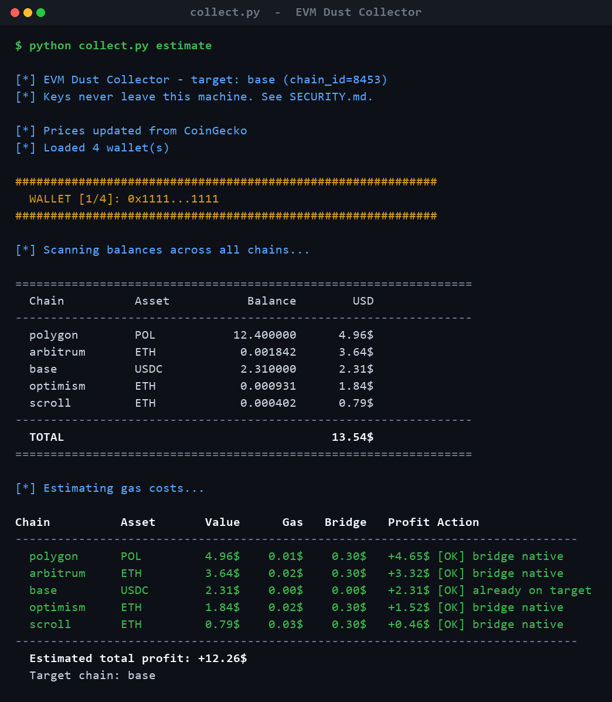

# EVM Dust Collector

Sweep small leftover balances ("dust") from many wallets across **33 EVM
chains** into a single wallet — then withdraw it all to your main address.

Built for the common end-game: you have crypto scattered across dozens of
throwaway wallets and chains, and you just want to pull it all together without
clicking through a bridge UI a hundred times.

It scans each wallet for native coins (ETH, BNB, AVAX, POL, …) and ERC-20s
(USDC, USDT, EURA), bridges everything to Base via Relay (with LiFi and the
Polygon zkEVM native bridge as fallbacks), and sends the result to your wallet.

> ### 🔒 Is this a scam? No — and you don't have to take my word for it.
> This tool reads seed phrases, which is exactly what a drainer does too. So
> **don't trust this README — verify the code.** Your keys are used only to
> sign transactions *locally*; they are never written to disk, logged, or put
> in any network request. **[SECURITY.md](SECURITY.md) shows you the two `grep`
> commands that prove it in under two minutes**, plus how to watch the live
> network traffic yourself.

---

## Example

A read-only `estimate` run scans every wallet, values the scattered dust, and
shows exactly what's worth bridging — *example output with placeholder
addresses:*



---

## Install

```bash
git clone <this-repo> && cd evm-dust-collector
python -m venv venv && source venv/bin/activate   # Windows: venv\Scripts\activate
pip install -r requirements.txt
```

Requires Python 3.10+. Works on both web3 6.x and 7.x.

## Set up wallets

Copy `.env.example` to `.env` and add your wallets (one per line). `.env` is
git-ignored.

```
# seed phrase (address derived automatically):
word1 word2 word3 ... word12

# address + seed phrase:
0xADDRESS word1 word2 ... word12

# address + private key:
0xADDRESS=0xPRIVATEKEY

# private key alone:
0xPRIVATEKEY

# address alone (read-only, unless a phrase or key below makes it):
0xADDRESS=
```

Many wallets: list their addresses as `0xADDRESS=` lines and paste the seed
phrases (or keys) anywhere in the same file. Each address gets the key of the
phrase that makes it — whether each wallet has its own phrase or all come from
one (accounts `m/44'/60'/0'/0/0` to `/199` of a single phrase are searched).
A phrase that gives a listed address its key adds no wallet of its own, so a
phrase shared with your main wallet doesn't pull the main wallet in. An
address nothing makes stays read-only: `Loaded N wallet(s), K with a key`
tells you what is missing.

## Use

```bash
# 1. Scan every wallet across all chains (read-only — no key needed)
python collect.py scan

# 1b. Faster parallel scan (native balances only)
python collect.py audit

# 2. Estimate gas + bridge fees, see what's profitable to move
python collect.py estimate

# 3. Dry run the bridging (simulates, sends nothing)
python collect.py collect

# 4. Bridge everything to Base for real
python collect.py collect --live --yes

# 5. Withdraw all from Base to your main wallet
python collect.py withdraw --to 0xYOUR_MAIN_WALLET --live

# 6. (optional) Seed gas to wallets holding ERC-20 dust but no gas
python collect.py distribute --live
```

Or, with many wallets, skip the per-wallet bridging: sweep everything to one
address chain by chain (a plain transfer costs a fraction of a cent on most
L2s), then bridge once from there.

```bash
python collect.py sweep --to 0xDESTINATION            # plan only, sends nothing
python collect.py sweep --to 0xDESTINATION --live     # asks once, then sends
python collect.py sweep --to 0xDESTINATION --chains arbitrum,zksync --live
```

`python -m dust_collector <command>` works identically to `python collect.py`.

## Commands

| Command | What it does | Needs a key? |
|---------|--------------|--------------|
| `scan` | Full scan (native + ERC-20) of each wallet | no |
| `audit` | Fast parallel native-only scan | no |
| `estimate` | Scan + gas/bridge cost + profitability | no |
| `collect` | Bridge profitable balances to target (dry run unless `--live`) | yes |
| `withdraw` | Send target-chain balance to `--to` address | yes |
| `distribute` | Send gas from the first wallet to others | yes |
| `sweep` | Send every wallet's native + listed ERC-20 balances to `--to`, on each chain (plan unless `--live`) | only with `--live` |

## Flags

| Flag | Description |
|------|-------------|
| `--live` | Actually send transactions (otherwise dry run) |
| `--yes` / `-y` | Auto-confirm each transaction |
| `--wallet 0x…` | Use a single wallet (skip `.env`) |
| `--target ID` | Target chain id (default `8453` = Base) |
| `--to 0x…` | Withdraw / sweep destination (or set `MAIN_WALLET` env var) |
| `--chains a,b` | Sweep only these chains (names as in `config.py`) |
| `--amount USD` | USD amount to withdraw (`0` = max) |
| `--env PATH` | Path to the wallets file (default `./.env`) |

## How it works

1. **Scan** — native + ERC-20 balances on every chain for each wallet.
2. **Estimate** — gas + bridge fees per balance; skips anything not worth moving.
3. **Bridge** — sends to Base via the right adapter per chain:
   Relay (most chains) · LiFi (Lens GHO) · native bridge (Polygon zkEVM → L1).
   Sends 82% of a native balance, keeping the rest for gas + L1 fees.
4. **Withdraw** — sends the consolidated balance from Base to your main wallet.

**Sweep** works differently: no bridge. Each wallet sends its balance to the
destination on the chain where it sits — the native coin less the worst-case
fee (gas at a ceiling of 1.3× the base fee, plus the L1 data fee on OP-stack
chains and Scroll), and the ERC-20s listed in `config.py` with a standard
`transfer`. A balance under `SWEEP_MIN_USD` or one whose fee would take more
than `SWEEP_MAX_FEE_SHARE` of it stays put. Chains whose node is down or
answers with another chain id are skipped up front, and a wallet with a
transaction still in flight on a chain is left alone there until the next run.

## Supported chains (33)

Ethereum, Arbitrum, Optimism, Base, Polygon, BSC, Avalanche, Fantom, zkSync,
Linea, Scroll, Gnosis, Mantle, Celo, ZetaChain, Manta, Lens, Zora, Taiko,
Polygon zkEVM, Abstract, Cyber, Blast, Mode, CORE, Gravity, Sonic, Sei, Bob,
Worldchain, Ink, Unichain, Lisk.

All chains and RPC endpoints live in one place: `dust_collector/config.py`.

## What leaves your machine

Nothing about your keys. Only:

- **RPC nodes** — your public address (balance reads) and signed transactions.
- **Relay / LiFi** — your public address + amount, to fetch a bridge route.
- **CoinGecko** — token names only, for USD prices.

No telemetry. Full breakdown and how to verify: **[SECURITY.md](SECURITY.md)**.

## Project layout

```
collect.py                  # CLI entry point
dust_collector/
  config.py     # chains, tokens, constants — single source of truth
  wallets.py    # .env parser (seed / address+seed / address=key / key / address)
  prices.py     # CoinGecko + fallbacks
  web3compat.py # web3 6.x / 7.x shim
  bridges.py    # Relay / LiFi / zkEVM adapters behind one interface
  core.py       # scan / estimate / collect / withdraw / distribute
  sweep.py      # sweep: plain transfers to one address, chain by chain
  cli.py        # argument parsing
tests/          # pytest: wallet loading and sweep against fake nodes
```

## ⚠️ Disclaimer

Unaudited software that moves real funds across bridges — **you can lose money**.
Always dry-run first, test with one low-value wallet, and use only wallets you
control. See **[DISCLAIMER.md](DISCLAIMER.md)**. MIT licensed
([LICENSE](LICENSE)).
